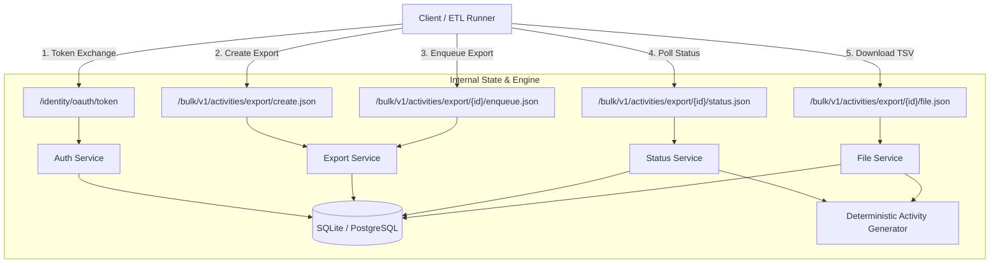

# Marketo Bulk Activity API Simulator

A high-fidelity Python backend simulator for the Marketo Bulk Activity Export API (specifically activity type 2: *Fill Out Form*). Built with **Python 3.12**, **FastAPI**, **Pydantic v2**, and **SQLAlchemy 2.x**, this service provides a realistic, reproducible upstream data source for downstream Ab Initio ETL and Databricks ingestion pipelines.

---

## Table of Contents

1. [Project Purpose](#1-project-purpose)
2. [API Architecture & Design](#2-api-architecture--design)
3. [Complete Endpoint Sequence](#3-complete-endpoint-sequence)
4. [Authentication & Token Security](#4-authentication--token-security)
5. [TSV Output & Format Philosophy](#5-tsv-output--format-philosophy)
6. [Exact 21-Column TSV Schema](#6-exact-21-column-tsv-schema)
7. [Null Handling & FormFields PHP Serialization](#7-null-handling--formfields-php-serialization)
8. [Deterministic Synthetic Data Generation](#8-deterministic-synthetic-data-generation)
9. [Job Lifecycle & Timestamp-Based State Derivation](#9-job-lifecycle--timestamp-based-state-derivation)
10. [Active Job Throttling & Queue Concurrency](#10-active-job-throttling--queue-concurrency)
11. [Zero-Record Mock Testing](#11-zero-record-mock-testing)
12. [Environment Configuration Reference](#12-environment-configuration-reference)
13. [Local Setup & Development](#13-local-setup--development)
14. [Docker & PostgreSQL Setup](#14-docker--postgresql-setup)
15. [Alembic Database Migrations](#15-alembic-database-migrations)
16. [Verification, Tests, Ruff & MyPy](#16-verification-tests-ruff--mypy)
17. [Complete cURL Workflow Walkthrough](#17-complete-curl-workflow-walkthrough)
18. [Demonstration Script Execution](#18-demonstration-script-execution)
19. [Render Cloud Deployment](#19-render-cloud-deployment)
20. [Security & Production Considerations](#20-security--production-considerations)
21. [Known POC Limitations & Future Activity Types](#21-known-poc-limitations--future-activity-types)

---

## 1. Project Purpose

In enterprise data platforms, integrating with Marketo's asynchronous bulk export endpoints is essential for extracting user interactions such as form submissions. However, developing and testing complex ETL jobs (in Ab Initio or Databricks) directly against sandbox or production Marketo instances introduces severe rate-limiting hurdles, inconsistent data volumes, lack of edge cases (such as mixed date formats and serialized arrays), and operational friction.

This simulator faithfully replicates:
- The exact 5-step asynchronous polling lifecycle of Marketo Bulk Activity Export.
- Complete 21-column TSV data schemas with byte-accurate PHP serialized `FormFields`.
- Deterministic data generation where the same export job parameters consistently yield byte-for-byte identical TSV output, identical SHA-256 checksums, and exact file sizes.
- Real-world dirty data edge cases (e.g. Unix timestamps mixed with ISO strings, empty strings, and null PHP values) that previously challenged Ab Initio parsers.

---

## 2. API Architecture & Design



### Architectural Principles
1. **Asynchronous Simulation Without Workers**: Rather than introducing background worker daemons (such as Celery or Redis), job state progression (`Created` -> `Queued` -> `Processing` -> `Completed`) is mathematically derived from persisted timestamps (`queued_at`, `started_at`, `finished_at`).
2. **Stateless TSV Materialization**: The TSV files are generated on demand from a seeded pseudo-random generator, verified against persisted metrics, streamed via `tempfile.SpooledTemporaryFile`, and discarded, eliminating disk bloat.
3. **Strict Validation**: All endpoints enforce `extra="forbid"` on Pydantic models. Unrecognized query parameters, invalid date ranges, or unexpected body fields are rejected immediately.

---

## 3. Complete Endpoint Sequence

| Step | HTTP Method | Endpoint Path | Content-Type | Response Type | Description |
|---|---|---|---|---|---|
| **1** | `POST` | `/identity/oauth/token` | `application/x-www-form-urlencoded` | JSON | Exchanges client credentials for a Bearer token |
| **2** | `POST` | `/bulk/v1/activities/export/create.json` | `application/json` | JSON | Validates date range and creates an export job |
| **3** | `POST` | `/bulk/v1/activities/export/{exportId}/enqueue.json` | `application/json` | JSON | Calculates record counts and enqueues job |
| **4** | `GET` | `/bulk/v1/activities/export/{exportId}/status.json` | None | JSON | Polls status (`Created`, `Queued`, `Processing`, `Completed`) |
| **5** | `GET` | `/bulk/v1/activities/export/{exportId}/file.json` | None | TSV | Streams the completed 21-column tab-delimited file |

---

## 4. Authentication & Token Security

- **Grant Type**: Exclusively supports `grant_type=client_credentials`.
- **Timing Protection**: `MOCK_CLIENT_ID` and `MOCK_CLIENT_SECRET` are verified using constant-time string comparison (`hmac.compare_digest`).
- **Cryptographic Generation**: Tokens are created via `secrets.token_urlsafe(32)`.
- **Hashed Persistence**: Raw tokens are **never stored** in the database. An HMAC-SHA256 digest computed with `TOKEN_HASH_SECRET` is persisted.
- **Log Hygiene**: Authorization headers, raw tokens, and secrets are systematically omitted from structured application logs.
- **Header Delivery**: Tokens must be supplied via `Authorization: Bearer <access_token>`. Access tokens in URL query strings are explicitly rejected with code `601`.

---

## 5. TSV Output & Format Philosophy

- **TSV Only**: CSV is rejected. The API does not accept `"format": "TSV"` in requests (format is strictly enforced internally).
- **The `file.json` Contract**: In strict accordance with the real Marketo Bulk Activity API specification, the file download endpoint ends with the URL suffix `file.json`, but serves raw TSV bytes with header:
  `Content-Type: text/tab-separated-values; charset=utf-8`
- **Delimiter Rules**:
  - Delimiter: horizontal tab (`\t`)
  - Line terminator: Unix newline (`\n`)
  - Quoting: Minimal quoting using `csv.QUOTE_MINIMAL`
  - Byte Order Mark (BOM): None

---

## 6. Exact 21-Column TSV Schema

Every data row parses into exactly 21 fields:

| # | Column Name | Sample Logical Value | Description / Rules |
|---|---|---|---|
| 1 | `marketoGUID` | `86012481` | Unique numeric identifier for the activity |
| 2 | `leadId` | `820169` | Numeric synthetic lead identifier (can repeat) |
| 3 | `activityDate` | `2026-11-02T06:44:01Z` | UTC ISO-8601 timestamp ending in `Z` |
| 4 | `activityTypeId` | `2` | Always `2` (Fill Out Form) |
| 5 | `primaryAttributeValueId` | `1029` | Weighted choice: `1029` (80%) or `1356` (20%) |
| 6 | `primaryAttributeValue` | `AEM·Form·Testing.AEM·Form·Testing` | Corresponds to attribute value ID |
| 7 | `CAPTCHANormalizedScore` | *empty* | Null top-level field |
| 8 | `CAPTCHAProvider` | *empty* | Null top-level field |
| 9 | `CAPTCHARawScore` | *empty* | Null top-level field |
| 10 | `ClientIPAddress` | `198.51.100.12` | Null for AEM forms; synthetic documentation IP for landing forms |
| 11 | `FormFields` | `a:21:{s:11:"FirstName";s:6:"Sample";...}` | PHP-serialized associative array |
| 12 | `mRFSBrand` | `BT` | `BT` for AEM callback forms; null for others |
| 13 | `mRFSConsentChannel` | *empty* | Null top-level field |
| 14 | `mRFSConsentType` | *empty* | Null top-level field |
| 15 | `mRFSCountry` | *empty* | Null top-level field |
| 16 | `ProgramName` | *empty* | Null top-level field |
| 17 | `ProgramType` | *empty* | Null top-level field |
| 18 | `QueryParameters` | `{}` | Literal JSON `{}` or query parameters |
| 19 | `ReferrerURL` | `https://business.example.test/...` | Synthetic URL (no HTML anchors) |
| 20 | `UserAgent` | `Mozilla/5.0...` | Synthetic browser UA for landing forms; null for AEM |
| 21 | `WebpageID` | `17538` | Numeric webpage identifier |

---

## 7. Null Handling & FormFields PHP Serialization

### Top-Level Nulls
Top-level `None` or empty string values in Python are emitted as **empty fields between tab characters** (`\t\t`). The literal string `"Null"` is never written.

### FormFields PHP Serialization
Nested form field dictionaries are serialized using PHP's standard associative array format:
- String: `s:<byte_len>:"<value>";` (where `<byte_len>` is `len(value.encode('utf-8'))`)
- Integer: `i:<value>;`
- Null: `N;`
- Boolean: `b:1;` or `b:0;`
- Array: `a:<count>:{<serialized_key><serialized_value>...}`

#### Mixed Date Field Values
To simulate the legacy Ab Initio parsing conditions:
- **65%**: Integer Unix timestamp (`i:1790053200;`)
- **20%**: Empty string (`s:0:"";`)
- **10%**: Null (`N;`)
- **5%**: ISO string (`s:10:"2026-01-15";`)

---

## 8. Deterministic Synthetic Data Generation

Reproducibility is guaranteed via a canonical seed string:
```
<exportId>|2|<startAt-UTC>|<endAt-UTC>|TSV
```
The SHA-256 digest of this canonical string is converted into a 64-bit integer seed for a local `random.Random(seed)` instance.
- **Never uses global random or global faker state.**
- The same export ID consistently generates identical record counts, timestamps, GUIDs, FormFields, and byte checksums.

---

## 9. Job Lifecycle & Timestamp-Based State Derivation

1. **Created**: On `POST /create.json`, an `export_jobs` row is inserted. Status is `Created`.
2. **Queued**: On `POST /{id}/enqueue.json`, `queued_at` is set to `utc_now()`, `started_at = queued_at + QUEUE_DELAY_SECONDS`, and `finished_at = started_at + PROCESSING_DELAY_SECONDS`.
3. **Processing**: Evaluated dynamically when `utc_now() >= started_at` and `utc_now() < finished_at`.
4. **Completed**: When `utc_now() >= finished_at`. On first completion, the TSV is generated to calculate exact byte size and SHA-256 checksum, which are stored in the database.

---

## 10. Active Job Throttling & Queue Concurrency

- A maximum of `MAX_ACTIVE_EXPORT_JOBS=10` concurrent jobs in `Queued` or `Processing` status is enforced.
- When full, enqueue calls return HTTP 422:
  ```json
  {
    "requestId": "<request-id>",
    "success": false,
    "errors": [{"code": "1029", "message": "Too many jobs in queue"}]
  }
  ```
- For PostgreSQL, `SELECT ... FOR UPDATE` row-level locks prevent race conditions during enqueueing.

---

## 11. Zero-Record Mock Testing

For automated test suites and validation pipelines, passing the header:
```
X-Mock-Record-Count: 0
```
to `enqueue.json` triggers a zero-record job:
- **Permitted only in `APP_ENV=local` or `APP_ENV=test`** (rejected in production).
- When polled, status reaches `Completed` with `numberOfRecords: 0`.
- Calling `GET /{id}/file.json` returns **HTTP 204 No Content** with headers `X-Export-Id`, `X-Number-Of-Days`, and `X-Record-Count: 0`.

---

## 12. Environment Configuration Reference

| Variable | Default Value | Description |
|---|---|---|
| `APP_NAME` | `Marketo API Simulator` | Human-readable service name |
| `APP_ENV` | `local` | `local`, `test`, or `production` |
| `APP_HOST` | `0.0.0.0` | Host interface |
| `APP_PORT` | `8000` | HTTP port |
| `LOG_LEVEL` | `INFO` | Logging level (`DEBUG`, `INFO`, `WARNING`) |
| `DATABASE_URL` | `sqlite:///./marketo_simulator.db` | SQLAlchemy connection URL |
| `MOCK_CLIENT_ID` | `marketo-poc-client` | Client credentials client ID |
| `MOCK_CLIENT_SECRET` | `change-me` | Client credentials secret |
| `ACCESS_TOKEN_TTL_SECONDS` | `3599` | Access token lifetime in seconds |
| `TOKEN_HASH_SECRET` | `replace-with-a-long-random-value` | Key used for HMAC hashing of tokens |
| `QUEUE_DELAY_SECONDS` | `2` | Delay before job enters `Processing` |
| `PROCESSING_DELAY_SECONDS` | `5` | Delay before job enters `Completed` |
| `MAX_EXPORT_RANGE_DAYS` | `30` | Maximum date range in calendar days |
| `MAX_ACTIVE_EXPORT_JOBS` | `10` | Maximum concurrent active jobs |
| `MIN_RECORDS_PER_DAY` | `1` | Minimum synthetic records per day |
| `MAX_RECORDS_PER_DAY` | `5` | Maximum synthetic records per day |
| `MAX_RECORDS_PER_EXPORT` | `10000` | Safety limit on total generated records |

---

## 13. Local Setup & Development

### Prerequisites
- Python 3.12+
- Virtual environment (`venv`)

### Installation
```bash
cd marketo-api-simulator

# 1. Create and activate virtual environment
python3.12 -m venv .venv
source .venv/bin/activate

# 2. Install dependencies
pip install -r requirements.txt

# 3. Copy environment configuration
cp .env.example .env

# 4. Start local development server
./scripts/run_local.sh
```
API docs will be available at [http://localhost:8000/docs](http://localhost:8000/docs).

---

## 14. Docker & PostgreSQL Setup

Run the multi-container stack with PostgreSQL:
```bash
docker compose up --build
```
This spins up:
- `marketo-db`: PostgreSQL 16 on port 5432 with health check and persistent volume.
- `marketo-api`: API container running non-root with automatic database connectivity.

---

## 15. Alembic Database Migrations

Apply database migrations:
```bash
# Upgrade to latest revision
alembic upgrade head

# Rollback migration
alembic downgrade -1
```

---

## 16. Verification, Tests, Ruff & MyPy

Run the complete test suite:
```bash
# Run pytest with coverage
pytest

# Run Ruff linter
ruff check .

# Run MyPy type checker
mypy app/
```

---

## 17. Complete cURL Workflow Walkthrough

### Step 1: Obtain Access Token
```bash
curl -s -X POST http://localhost:8000/identity/oauth/token \
  -H "Content-Type: application/x-www-form-urlencoded" \
  -d "grant_type=client_credentials&client_id=marketo-poc-client&client_secret=change-me"
```
*Response:*
```json
{
  "access_token": "a1b2c3d4e5f6g7h8i9j0k1l2m3n4o5p6q7r8s9t0u1v2",
  "token_type": "bearer",
  "expires_in": 3599,
  "scope": "marketo.mock.api"
}
```

### Step 2: Create Export Job
```bash
curl -s -X POST http://localhost:8000/bulk/v1/activities/export/create.json \
  -H "Authorization: Bearer <access_token>" \
  -H "Content-Type: application/json" \
  -d '{
    "filter": {
      "createdAt": {
        "startAt": "2026-11-01T00:00:00Z",
        "endAt": "2026-11-06T23:59:59Z"
      },
      "activityTypeIds": [2]
    }
  }'
```
*Response:*
```json
{
  "requestId": "2f6a73c1-0428-4ef7-b2fb-ec558b3a0c51",
  "success": true,
  "result": [
    {
      "exportId": "013c8d50-2d7c-44d4-b70e-a9e9ff76afd0",
      "status": "Created",
      "createdAt": "2026-11-16T12:00:00Z",
      "format": "TSV"
    }
  ]
}
```

### Step 3: Enqueue Export Job
```bash
curl -s -X POST http://localhost:8000/bulk/v1/activities/export/013c8d50-2d7c-44d4-b70e-a9e9ff76afd0/enqueue.json \
  -H "Authorization: Bearer <access_token>"
```
*Response:*
```json
{
  "requestId": "9d1b7083-4a16-43f1-b99b-432d8471b05a",
  "success": true,
  "result": [
    {
      "exportId": "013c8d50-2d7c-44d4-b70e-a9e9ff76afd0",
      "status": "Queued",
      "createdAt": "2026-11-16T12:00:00Z",
      "queuedAt": "2026-11-16T12:00:05Z",
      "format": "TSV"
    }
  ]
}
```

### Step 4: Poll Export Job Status
```bash
curl -s -X GET http://localhost:8000/bulk/v1/activities/export/013c8d50-2d7c-44d4-b70e-a9e9ff76afd0/status.json \
  -H "Authorization: Bearer <access_token>"
```
*Completed Response:*
```json
{
  "requestId": "3a7b98f2-8921-4320-aa71-b847120a1122",
  "success": true,
  "result": [
    {
      "exportId": "013c8d50-2d7c-44d4-b70e-a9e9ff76afd0",
      "status": "Completed",
      "createdAt": "2026-11-16T12:00:00Z",
      "queuedAt": "2026-11-16T12:00:05Z",
      "startedAt": "2026-11-16T12:00:07Z",
      "finishedAt": "2026-11-16T12:00:12Z",
      "format": "TSV",
      "numberOfDays": 6,
      "numberOfRecords": 19,
      "fileSize": 45237,
      "fileChecksum": "sha256:7f9a2b8e3d4c5e6f1a0b9c8d7e6f5a4b3c2d1e0f"
    }
  ]
}
```

### Step 5: Download TSV Source File
```bash
curl -v -X GET http://localhost:8000/bulk/v1/activities/export/013c8d50-2d7c-44d4-b70e-a9e9ff76afd0/file.json \
  -H "Authorization: Bearer <access_token>" \
  -o marketo_fillout_form_013c8d50-2d7c-44d4-b70e-a9e9ff76afd0.tsv
```

---

## 18. Demonstration Script Execution

Run the automated end-to-end verification script:
```bash
python3 scripts/demo_workflow.py
```
This script runs the entire sequence, downloads the TSV, verifies the 21 columns, asserts row counts, and verifies the SHA-256 checksum.

---

## 19. Render Cloud Deployment

Deploy directly via `render.yaml`:
1. Push this repository to GitHub.
2. In Render, select **New -> Blueprint**.
3. Point to the repository. Render will automatically provision the PostgreSQL database, execute migrations, and start the FastAPI service.

---

## 20. Security & Production Considerations

- **Secret Rotation**: In production, startup fails if `MOCK_CLIENT_SECRET=change-me` or `TOKEN_HASH_SECRET=replace-with-a-long-random-value`.
- **Database Isolation**: The service supports PostgreSQL connection pooling and runs as an unprivileged user inside Docker (`appuser`).
- **Data Protection**: All generated emails use `example.com`, and URLs use `example.test`. No real personal or infrastructure details are exposed.

---

## 21. Known POC Limitations & Future Activity Types

### POC Limitations
- Currently implements activity type ID `2` (*Fill Out Form*).
- Status progression is time-simulated rather than tied to real CPU load.
- File compression (Gzip) is not enabled in this first POC version.

### Adding Future Activity Types
The architecture is modular:
1. Define new template generators in `app/generators/form_field_generator.py`.
2. Register the activity type ID in `app/generators/record_templates.py`.
3. Add the activity ID to the validator in `app/models/requests.py`.
No changes are required to authentication, queueing, repository, or download streaming services.
